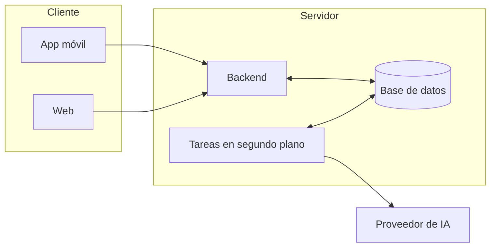

# Planner For Education

Plataforma para docentes que genera planificaciones, situaciones de aprendizaje e instrumentos de evaluación con apoyo de IA, alineados al currículo oficial. Incluye app móvil, versión web y un backend propio sobre Odoo.

**Sitio:** [plannerforeducation.com](https://plannerforeducation.com)

> El código fuente es privado porque es un producto comercial. Estos repositorios documentan el problema y las decisiones de diseño a alto nivel, sin detalles de configuración ni de negocio.

## El problema

Preparar planificaciones, rúbricas y pruebas toma muchas horas a los docentes, y deben cumplir el formato y los contenidos del currículo oficial. Planner automatiza esa preparación y entrega documentos listos para editar, imprimir y exportar a PDF.

## Mapa del proyecto

| Parte | Qué resuelve | Repositorio |
|---|---|---|
| **App móvil** | Planificar y generar documentos desde el teléfono | [planner-mobile](https://github.com/Jeisondls/planner-mobile) |
| **Versión web** | La misma app en el navegador | [planner-web](https://github.com/Jeisondls/planner-web) |
| **Backend** | Generación con IA, usuarios, suscripciones y facturación | [planner-odoo-backend](https://github.com/Jeisondls/planner-odoo-backend) |
| **Infraestructura** | Despliegue en contenedores | [planner-docker-infra](https://github.com/Jeisondls/planner-docker-infra) |

## Arquitectura general

## Retos principales y enfoque

| Reto | Enfoque |
|---|---|
| Las generaciones con IA tardan y pueden saturar el servidor | Procesamiento asíncrono en un proceso aparte, con recursos acotados |
| Los documentos deben seguir el currículo oficial | Catálogos curriculares como datos y generación con ese contexto |
| Una sola base de código para móvil y web | React Native con soporte web |
| Cobrar suscripciones y mantener el acceso al día | Integración con las tiendas de aplicaciones y facturación en el backend |
| Acceso seguro sin depender solo de contraseñas | Autenticación moderna con factores adicionales |
| Operar con pocos recursos | Contenedores con límites y actualizaciones remotas de la app |

## Tecnologías

Odoo · Python · PostgreSQL · Docker · React Native · Expo · TypeScript

## Autor

**Jeison De los Santos** · [LinkedIn](https://www.linkedin.com/in/jeisondelossantos/) · [GitHub](https://github.com/Jeisondls)
