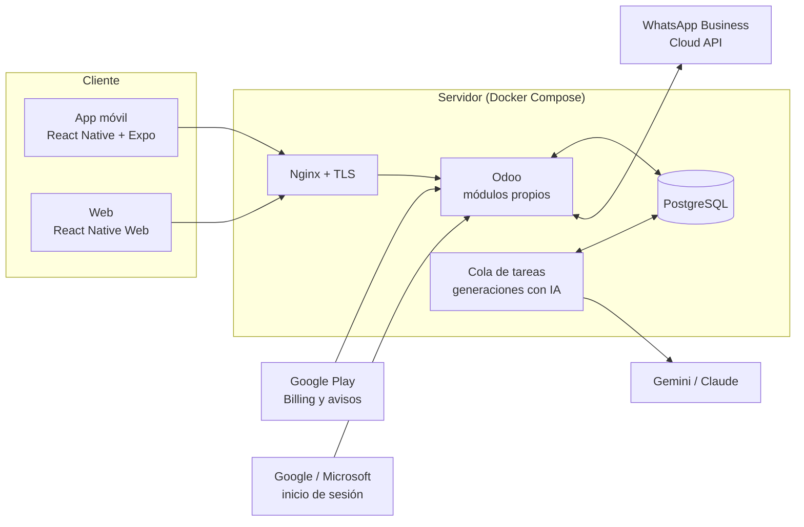

# Planner For Education

Plataforma para docentes que genera planificaciones, situaciones de aprendizaje e instrumentos de evaluación con apoyo de IA, alineados al currículo oficial. Incluye app móvil, versión web y un backend propio sobre Odoo.

**Sitio:** [plannerforeducation.com](https://plannerforeducation.com) · **App web:** [app.plannerforeducation.com](https://app.plannerforeducation.com)

> El código fuente es privado porque es un producto comercial. Estos repositorios documentan el problema, la arquitectura y las decisiones técnicas de cada parte.

## El problema

Preparar planificaciones, rúbricas y pruebas toma muchas horas a los docentes, y deben cumplir el formato y los contenidos del currículo oficial. Planner automatiza esa preparación y entrega documentos listos para editar, imprimir y exportar a PDF.

## Mapa del proyecto

| Parte | Qué resuelve | Repositorio |
|---|---|---|
| **App móvil** | Planificar y generar documentos desde el teléfono, con acceso seguro y suscripción | [planner-mobile](https://github.com/Jeisondls/planner-mobile) |
| **Versión web** | La misma app en el navegador, con interfaz adaptada a escritorio | [planner-web](https://github.com/Jeisondls/planner-web) |
| **Backend Odoo** | Generación con IA, licencias, WhatsApp, CRM, ventas, facturación y cobro | [planner-odoo-backend](https://github.com/Jeisondls/planner-odoo-backend) |
| **Infraestructura** | Docker, PostgreSQL, Nginx y TLS | [planner-docker-infra](https://github.com/Jeisondls/planner-docker-infra) |

## Arquitectura general

## Retos principales y cómo los resolví

| Reto | Solución |
|---|---|
| Las generaciones con IA tardan y pueden saturar el servidor | Cola asíncrona en un proceso aparte, con estados y tope de recursos |
| Los documentos deben seguir el currículo oficial | Catálogos curriculares como datos y generación con el contexto del currículo |
| Una sola base de código para móvil y web | Expo con React Native Web y componentes específicos de escritorio |
| Cobrar suscripciones y mantener las licencias al día | Google Play Billing verificado en el servidor, con avisos y facturas en Odoo |
| Acceso seguro sin depender solo de contraseñas | Passkeys, verificación en dos pasos, biometría y OAuth |
| Operar con pocos recursos | Contenedores con límites, healthchecks y actualizaciones OTA |

## Tecnologías

Odoo · Python · PostgreSQL · Docker · Nginx · React Native · Expo · TypeScript · TanStack Query · Google Play Billing · WhatsApp Cloud API · Gemini · Claude

## Autor

**Jeison De los Santos** · [LinkedIn](https://www.linkedin.com/in/jeisondelossantos/) · [GitHub](https://github.com/Jeisondls)
